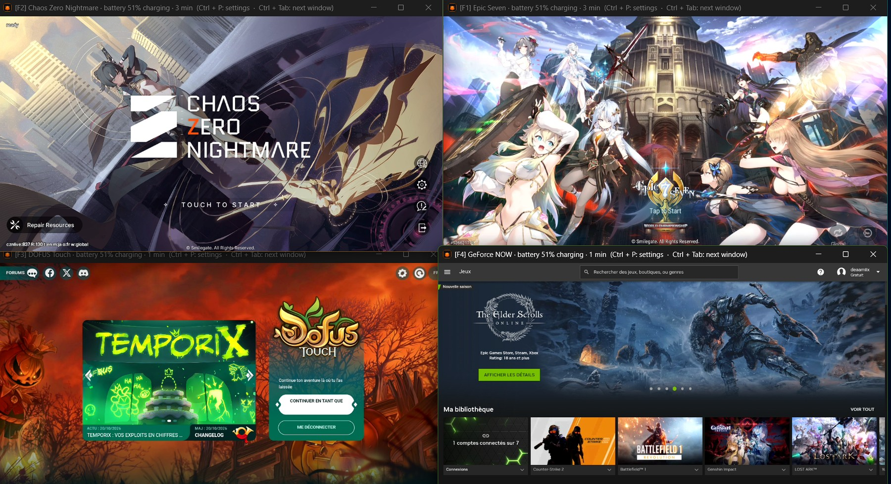
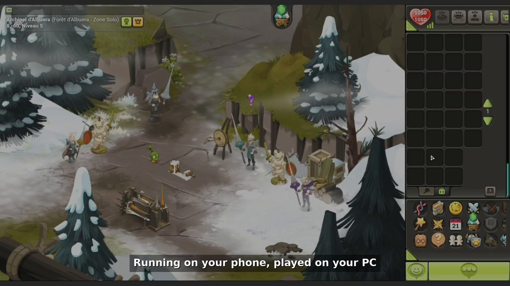
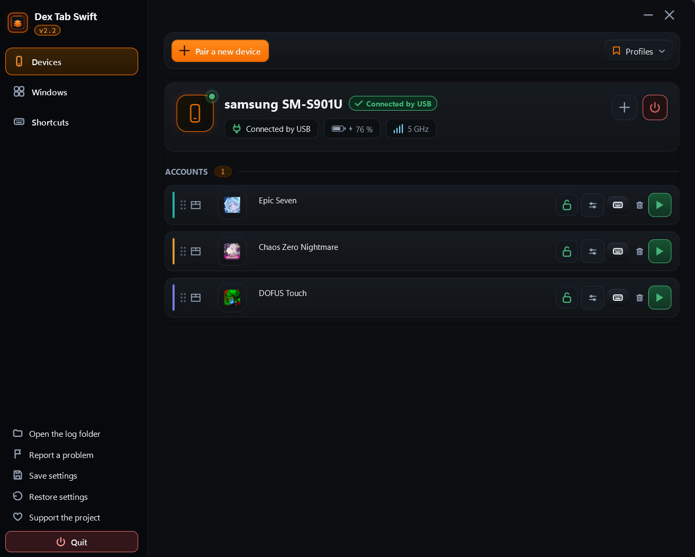
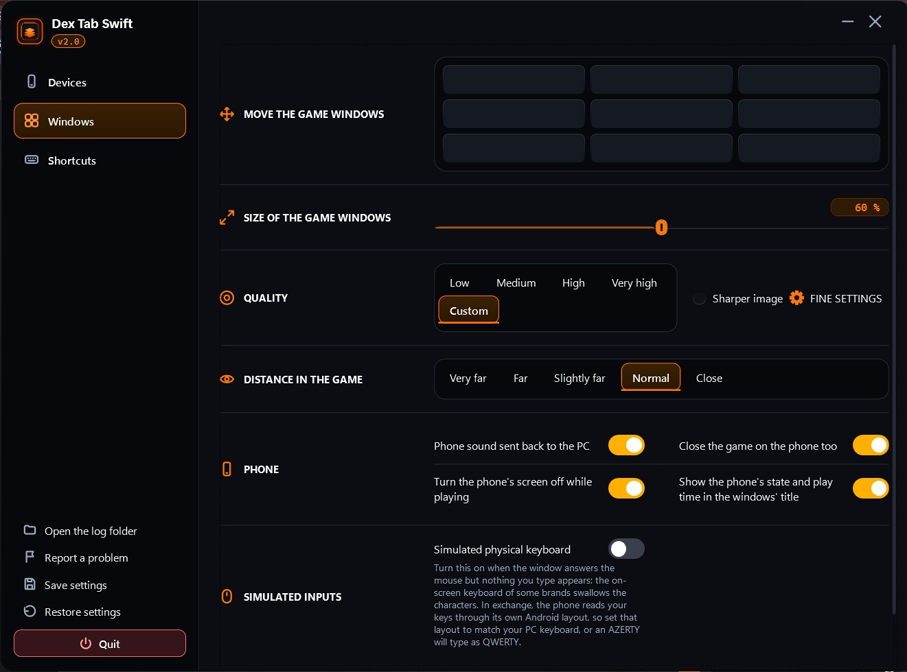
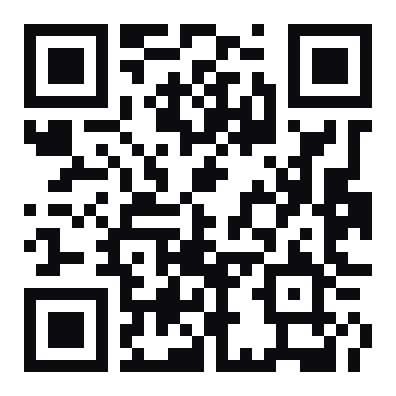

# 🟧 Dex Tab Swift

**Run several Android apps on one PC screen — no emulator.** 🚀

Dex Tab Swift mirrors your applications from your **real Android phone** 📱 to your PC, over USB 🔌 or Wi-Fi 📶. Your apps keep running on the phone; your PC becomes the big screen, the keyboard and the mouse.

🌐 **Live site: [dextabswift.github.io](https://dextabswift.github.io/)**

## 🎬 Watch the demo

**1 minute, English voiceover** — click the image to play. Also on the [website](https://dextabswift.github.io/#video).

---

## 🖥️ Display modes

- 🗂️ **Tabs** — every app in a single window, switch with one click or a hotkey
- ↔️ **Split** — your apps side by side on the same screen
- 🖥️ **Separate screens** — one app per monitor

## ✨ Features

- 🎛️ **Per-app quality** — resolution, frame rate and bitrate set for each app separately
- ⌨️ **Keymap per app** — map keyboard keys to taps, swipes and a ZQSD movement zone
- 🔊 **Sound on the PC**, 📴 phone screen off while you play
- 🧭 **One clean panel** — launch, stop and arrange everything from a single place
- 🔄 **Automatic recovery** — sessions reopen after a disconnection
- 🔒 **No cloud** — everything stays between your phone and your PC

## 📋 Requirements

- 🪟 A PC running **Windows**
- 🤖 An **Android** phone (USB cable or same Wi-Fi network)
- ✅ Your apps stay installed on the phone — Dex Tab Swift installs nothing on it

## 📸 Screenshots

**Devices — your phone and your apps, one panel**

**Windows — how your apps are arranged and displayed**

## ☕ Support the project

Dex Tab Swift is **free**. If it helps you, you can support its development:

- 💛 **Liberapay** (by card) : [liberapay.com/Deaa](https://liberapay.com/Deaa/)
- 💵 **USDT — TRON network (TRC20)** : `TNCFvYtPy2Q6P2nxfoQgqa1ANLMZhVqLK7`

⚠️ Send **only USDT via the TRON (TRC20) network** to this address.

## 🙏 Credits

Dex Tab Swift is built on the **official [scrcpy](https://github.com/Genymobile/scrcpy)** by Genymobile, the reference tool for Android screen mirroring — used **unmodified**, wrapped in a multi-instance control panel, alongside Android's official ADB.

## ⬇️ Get it

👉 **[dextabswift.github.io](https://dextabswift.github.io/)** — presentation and download.

---

*Dex Tab Swift — Multi-instance. Free · Windows · Android.*

*© 2026 Deaa — All rights reserved.*
